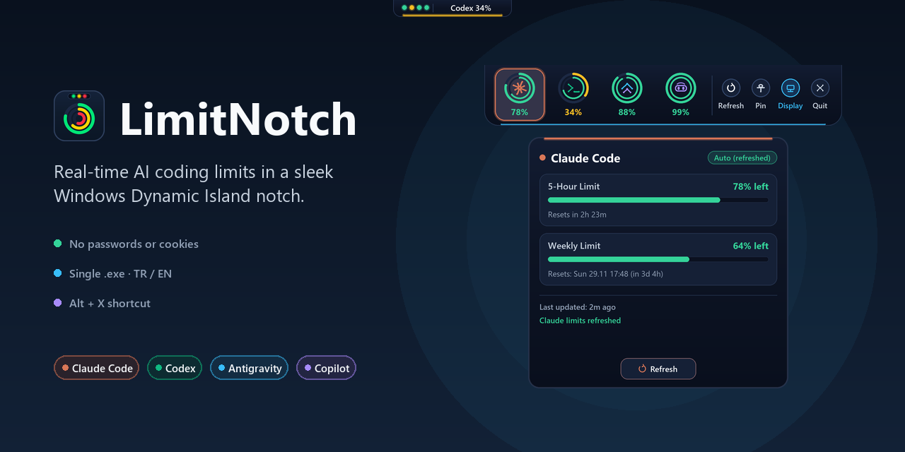
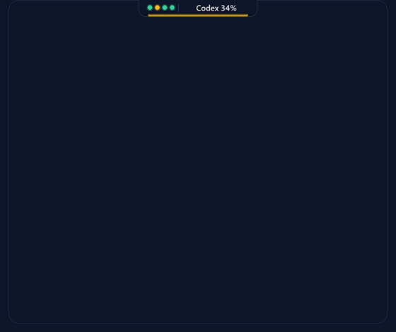

# LimitNotch

*Formerly Limit Çubuğu — [Türkçe README](README.tr.md)*



A lightweight Windows top-center Dynamic Island notch that displays real-time AI coding usage limits across multiple tools without opening their apps.



## Installation

### Windows Executable (Recommended)
1. Download `LimitNotch.exe` from the **Releases** page and double-click to run.
2. If Windows SmartScreen shows *"Windows protected your PC"*: click **More info** → **Run anyway** (the binary is unsigned in this release).

### From Source (Python 3.10+)
```powershell
git clone https://github.com/AlptekinZengin/LimitNotch.git
cd LimitNotch
py -3 -m pip install -r requirements.txt
pyw -3 limit_cubugu.pyw
```
You can also launch without a console window via `baslat.vbs` or `Limit-Cubugu.cmd`. To start on Windows login, place a shortcut to `LimitNotch.exe` (or `baslat.vbs`) inside `shell:startup`.

## Usage

- **Top-center notch:** Sits at the top center of the selected monitor (~168×24 px), showing status dots and the lowest remaining quota (or countdown if exhausted). Hover (~180 ms) or click to expand.
- **Global shortcut (`Alt + X`):** Toggles the capsule open/closed from any application.
- **Expanded panel:** Shows dual concentric progress rings per tool (outer = primary/5-hour, inner = weekly/secondary).
  Colors: green `>= 50%` · amber `20%–49%` · red `< 20%` · gray `no data`.
- **Detail card:** Hover over any tool icon to inspect exact percentages, progress bars, live countdowns, reset dates, and status notes, or click **Refresh** for that single tool.
- **Right-click menu:** Right-click the panel to select active tools (**Select tools…**) or switch the UI language (**Dil / Language → Türkçe / English**). Language defaults to your Windows display language.
- **Pin / Display / Quit:** Keep the panel open, cycle across monitors, or exit cleanly.

## Supported Tools

| Tool | Status | How limits are read |
|---|---|---|
| **Claude Code** | Stable | Runs `claude -p /usage --output-format json` (official CLI; credentials untouched) |
| **Codex** | Stable | Queries local `codex app-server` JSON-RPC (`account/rateLimits/read`) |
| **Antigravity** | Experimental | Reads local daemon port (`hub_*.json` + `RetrieveUserQuotaSummary`). If the desktop app is closed, LimitNotch launches it on a hidden Windows desktop with a separate profile, reads the quota and closes it again (~7 s, at most every 10 min; disable with `LIMIT_CUBUGU_AGY_GIZLI=0`). |
| **GitHub Copilot** | Experimental | Runs official GitHub CLI `gh api copilot_internal/user` (undocumented endpoint; monthly quota) |

> **Why is Cursor not supported?**
> Cursor personal accounts only expose usage via browser session cookies, which goes against their Terms of Service and LimitNotch's privacy rules. LimitNotch does not include manual input modes.

### Optional: Claude Code `statusLine` (Python users)
If you run LimitNotch from Python source, you can optionally mirror Claude Code's status line updates into `~/.limit-cubugu/durum.json` by adding this to `~/.claude/settings.json`:
```json
"statusLine": {
  "type": "command",
  "command": "py -3 \"<REPO_DIR>\\claude_limit_yakala.py\""
}
```

## Privacy & Security

- **No credentials or cookies:** LimitNotch never reads auth/token files, never touches browser cookies, and never makes direct internet requests on its own.
- **Local only:** It only executes each tool's official CLI or queries local loopback endpoints started by the tool itself.
- **Data storage:** All cached quotas and preferences stay locally at `%USERPROFILE%\.limit-cubugu\durum.json`.

## Troubleshooting

- **Antigravity says "closed":** Make sure the Antigravity desktop application is running. Running only the `agy` CLI does not publish a local CSRF file.
- **Copilot not shown:** Ensure GitHub CLI (`gh`) is installed and signed in (`gh auth login`), then right-click the panel → **Select tools…** to enable Copilot.
- **Tool not detected on first launch:** Verify the CLI is on `PATH` (or installed in its standard location) and re-open **Select tools…**.

## Contributing & Tests

See [CONTRIBUTING.md](CONTRIBUTING.md) for connector rules and the template in [docs/ornek_baglayici.py](docs/ornek_baglayici.py).

```powershell
py -3 -m unittest discover -p "test_*.py"
py -3 tara.py
```

## License

[MIT](LICENSE)

*Disclaimer: LimitNotch is an unofficial community tool. Claude, Codex, Antigravity, GitHub Copilot, and all related names/trademarks belong to their respective owners.*
