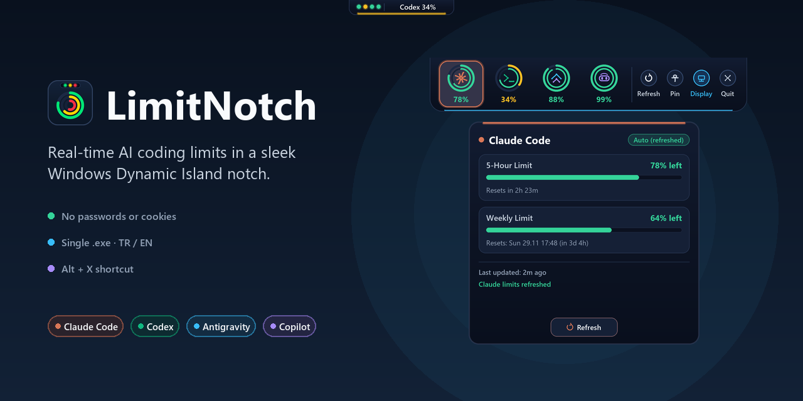
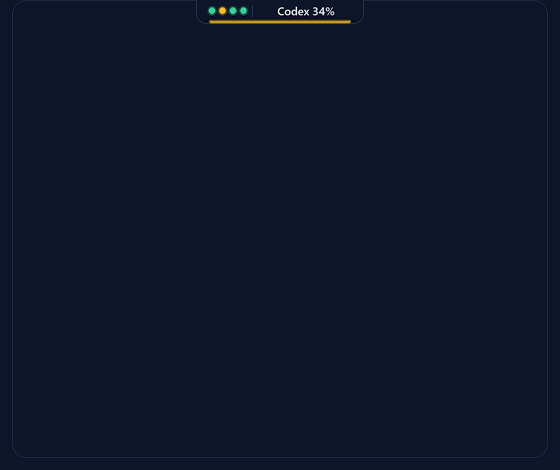

# LimitNotch (eski adıyla Limit Çubuğu)

*[English README](README.md)*



Seçili monitörün **en üst ortasında** (Dinamik Ada biçiminde) duran, birden fazla yapay zekâ kodlama aracının kullanım limitlerini uygulamalarını açmadan gösteren hafif Windows aracı.



## Kurulum

### Tek `.exe` ile (Önerilen)
1. **Releases** sayfasından `LimitNotch.exe` dosyasını indirip çift tıklayın.
2. Windows SmartScreen *"Windows kişisel bilgisayarınızı korudu"* uyarısı gösterirse: **Ek bilgi** → **Yine de çalıştır**'a tıklayın (ilk sürüm imzasızdır).

### Kaynak Koddan (Python 3.10+)
```powershell
git clone https://github.com/AlptekinZengin/LimitNotch.git
cd LimitNotch
py -3 -m pip install -r requirements.txt
pyw -3 limit_cubugu.pyw
```
Konsolsuz başlatmak için `baslat.vbs` veya `Limit-Cubugu.cmd` dosyalarını da kullanabilirsiniz. Windows açılışında başlaması için `LimitNotch.exe` (veya `baslat.vbs`) kısayolunu `shell:startup` klasörüne ekleyin.

## Kullanım

- **Üst orta çentik:** Seçili monitörün en üst ortasında (~168×24 px) durur; araç durum noktalarını ve en düşük kalan kotayı (dolmuşsa kalan süreyi) gösterir. Fareyle üzerine gelince (~180 ms) veya tıklayınca açılır.
- **Global kısayol (`Alt + X`):** Herhangi bir uygulamadayken paneli açar/kapatır.
- **Yatay kapsül:** Her araç için iki halka gösterir (dış = 5 saatlik/birincil, iç = haftalık/ikincil).
  Renkler: yeşil `%50+` · amber `%20–49` · kırmızı `< %20` · gri `veri yok`.
- **Detay kartı:** Simgenin üzerine gelince kalan yüzdeleri, canlı geri sayımı, yenilenme tarihini ve notları gösterir; karttaki **Yenile** yalnız o aracı tazeler.
- **Sağ tık menüsü:** Panelde sağ tıklayarak araçları seçebilir (**Araçları seç…**) veya dili değiştirebilirsiniz (**Dil / Language → Türkçe / English**). Başlangıçta Windows arayüz dilini otomatik algılar.
- **Sabit / Ekran / Çıkış:** Paneli açık sabitleyin, monitörler arasında geçin veya uygulamayı kapatın.

## Desteklenen Araçlar

| Araç | Durum | Nereden okur |
|---|---|---|
| **Claude Code** | Kararlı | `claude -p /usage --output-format json` (resmi CLI; kimlik dosyalarına dokunulmaz) |
| **Codex** | Kararlı | Yerel `codex app-server` JSON-RPC (`account/rateLimits/read`) |
| **Antigravity** | Deneysel | Bilgisayardaki yerel kapı (`hub_*.json` + `RetrieveUserQuotaSummary`). **Yalnız Antigravity masaüstü uygulaması açıkken okunur** (`agy` CLI tek başına çalışırken okunamaz). |
| **GitHub Copilot** | Deneysel | Resmi GitHub CLI `gh api copilot_internal/user` (belgesiz uç nokta; aylık kota) |

> **Cursor neden yok?**
> Cursor kişisel hesapları kullanımı yalnız tarayıcı çereziyle veriyor; kullanım şartları buna izin vermiyor ve LimitNotch'ta elle veri girişi bulunmuyor.

### İsteğe bağlı: Claude Code `statusLine` (Python kullananlar için)
Python kaynak kodundan çalıştırıyorsanız `~/.claude/settings.json` dosyanıza şu satırı ekleyerek ek `statusLine` yakalamasını açabilirsiniz:
```json
"statusLine": {
  "type": "command",
  "command": "py -3 \"<KLASÖR>\\claude_limit_yakala.py\""
}
```

## Gizlilik ve Güvenlik

- **Şifre, anahtar, çerez yok:** Hiçbir aracın giriş/kimlik dosyasını okumaz, tarayıcı çerezine dokunmaz, uygulama kendisi internete istek atmaz.
- **Yalnız yerel:** Yalnızca araçların kendi resmi programlarını çalıştırır veya yerel kapılarına sorar.
- **Veri konumu:** Tüm önbellek ve tercihler yerel olarak `%USERPROFILE%\.limit-cubugu\durum.json` dosyasında saklanır.

## Sık Sorunlar

- **Antigravity "kapalı" diyor:** Antigravity masaüstü uygulamasının açık olduğundan emin olun; yalnız `agy` CLI çalışırken yerel kapı anahtarı yayınlanmaz.
- **Copilot görünmüyor:** `gh` kurulu ve giriş yapılmış (`gh auth login`) olmalı; ardından panelde sağ tık → **Araçları seç…** ile Copilot'u işaretleyin.
- **İlk açılışta araç bulunamadı:** İlgili CLI'ın `PATH`'te olduğundan emin olup sağ tık → **Araçları seç…** açın.

## Katkı ve Testler

Yeni bağlayıcı ekleme kuralları için [CONTRIBUTING.md](CONTRIBUTING.md) ve şablon için [docs/ornek_baglayici.py](docs/ornek_baglayici.py) dosyalarına bakın.

```powershell
py -3 -m unittest discover -p "test_*.py"
py -3 tara.py
```

## Lisans

[MIT](LICENSE)

*Not: LimitNotch resmi bir ürün değildir; Claude, Codex, Antigravity, GitHub Copilot ve ilgili tüm adlar sahiplerinindir.*
